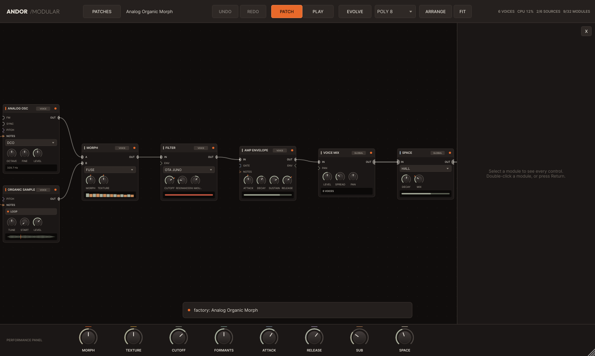
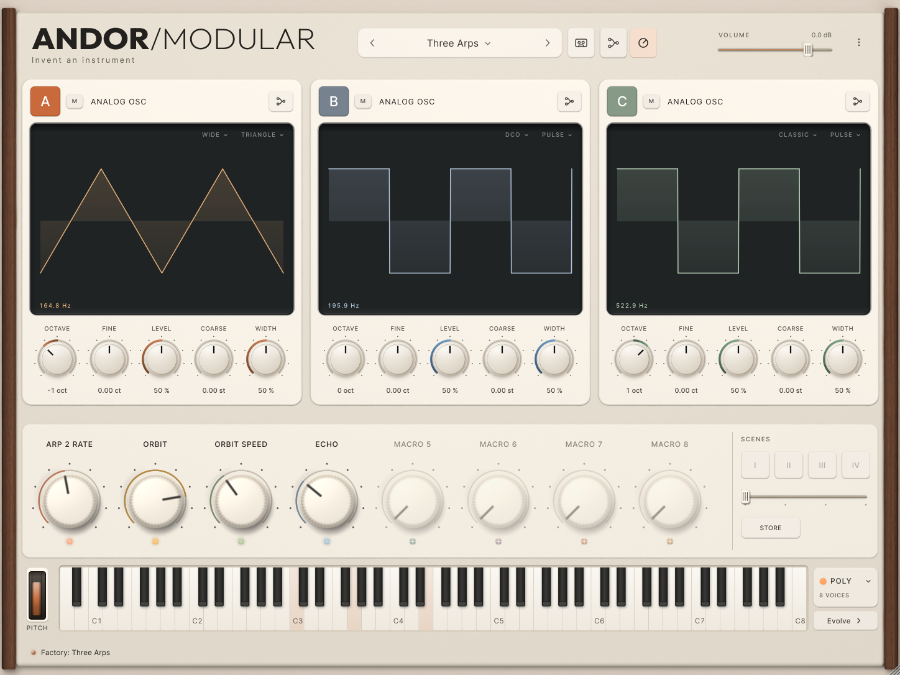

# ANDOR MODULAR — invent an instrument

ANDOR Modular is the third ANDOR instrument. OSP captures a sound; Analog shapes one; Modular
lets a musician **assemble an original instrument** from sound sources, transformations,
modulation, timing, space and performance controls — and then play it from a front panel
without seeing a single cable.

- **One family.** The interface is the ANDOR interface in Analog's walnut finish: the same
  housing, ceramic keys, ivory knobs, keyboard and type, with Analog's routing board grown into
  the patch board (docs/UI_COMPONENTS.md).

  
  

- **Hear sound immediately.** Right-click the empty board, type "analog", press Return, play:
  KEYBOARD → ANALOG OSC → AMP ENVELOPE → VOICE MIX → OUTPUT is made for you.
- **Complexity is optional.** Every module has a Quick face (2–4 controls, live telemetry) and
  a detail panel with everything else, shown only when it applies.
- **Everything connects where meaningful.** Typed ports (notes, pitch, gate, trigger, control,
  mono/stereo audio, clock) in three domains (per voice, global, note events), with the reason
  and a converter when a cable is refused.
- **A patch is an instrument.** Eight macros, four scenes with a continuous scene fader,
  EVOLVE, groups saved as reusable modules (`.andormodule`), all saved and recalled with the
  host project.

## Build

```sh
git submodule update --init          # external/osp and external/analog (not --recursive)
cmake -B build -G Ninja
cmake --build build
ctest --test-dir build --output-on-failure
```

The plugin (VST3 / Standalone; AU on macOS) and its product tests:

```sh
cmake -B build-plugin -G Ninja -DMODULAR_BUILD_PLUGIN=ON
cmake --build build-plugin
xvfb-run -a ./build-plugin/product/modular_product_tests_artefacts/Release/modular_product_tests   # Linux; screenshots: MODULAR_SCREENSHOT_DIR=dir
```

Tools: `build/tools/modular-render` (headless WAV renders, `--list`, `--validate`,
`--write-factory`), `build/tools/modular-bench` (performance matrix), `tools/render-demos.sh`
(the listening demos), `build/tools/make-samples` (ANDOR's own factory recordings).

## Layout

| Path | What |
|---|---|
| `dsp/` | the kernel, pure C++20 (no JUCE): graph, compiler, engine, 53 module types, edits, EVOLVE, assets |
| `product/` | the JUCE plugin: PATCH canvas, Quick Add, detail panel, PLAY, external host |
| `presets/` | 12 factory patches, 6 factory modules, 3 synthesised recordings |
| `tests/` | kernel tests (Catch2); `product/tests` product tests |
| `tools/` | renderer, benchmark, sample maker, demo script |
| `docs/` | audit, architecture, contracts, status, budgets, user guide |
| `external/` | pinned ANDOR OSP and ANDOR Analog (never modified here) |

Start with [docs/STATUS.md](docs/STATUS.md), [docs/architecture.md](docs/architecture.md) and
[docs/USER_GUIDE.md](docs/USER_GUIDE.md).

## macOS download

Every successful CI run (Actions → the run → Artifacts) carries `ANDOR-Modular-macOS-installer`
(a `.pkg`, unsigned for now: right-click → Open, or allow it under Privacy & Security) and
`ANDOR-Modular-macOS-test` (unzip, double-click `install.command`: installs for your user and
clears the download quarantine). Universal, macOS 11 or later. See `packaging/`.
