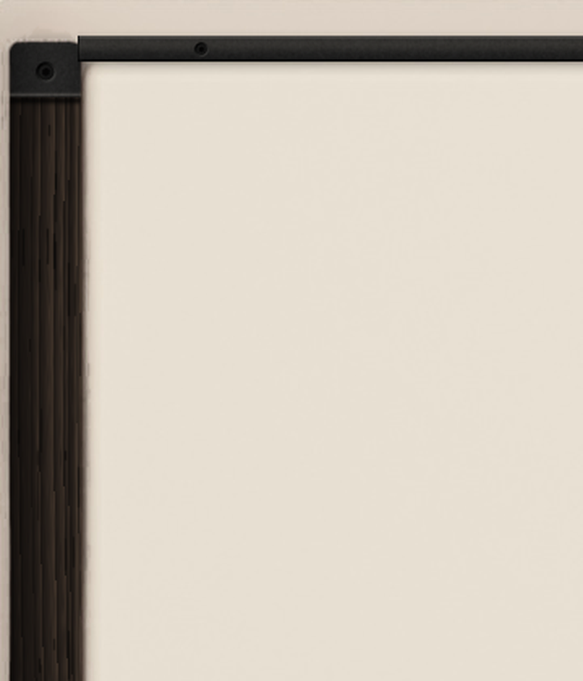
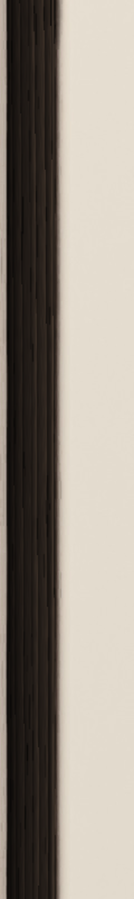

# Materials — ebonized ash and black anodized aluminium

ANDOR Modular's trim. OSP wears teak, Analog walnut; Modular wears **ebonized ash with black
anodized aluminium**. Only the trim is dark: the body is the family's bone ceramic, and the
board, the modules and the interaction colours are unchanged.




(Enlarged crops of the housing piece; the whole piece: `materials/ebonized-ash-housing.png`.)

## Specification

| Part | Material | How it is drawn |
|---|---|---|
| Left and right cheeks | Ebonized ash: ring-porous ash stained near-black, satin | Straight grain running down the cheek. Each growth ring is a band of open pores (black, matte) against dense latewood in very dark espresso that takes a little light. Ring widths from hairlines to broad bands, every ring with its own weight, a slow lean and waver, fine fibre. A soft satin highlight down the rounded face, held back in the pores; a hairline of light where the inner edge turns. Never a flat black |
| End caps (top and bottom of each cheek) | Black anodized aluminium, bead-blasted, satin | 17 reference px long, rounded with the cheek, a dark seam and a lit lip where metal meets wood |
| Top and bottom rails | The same aluminium | 8 reference px high, along the body's top and bottom edges between the caps: a lit top bevel, a dark bottom edge, one broad warm-neutral graphite reflection, a fine even bead-blast grain, a soft shadow on the ceramic under it |
| Fasteners | Dark countersunk hex-socket screws | Eight: one in each end cap (6.5 px), one near each end of each rail (4.5 px). Lit from the top left like everything else; no brass, no copper |
| Body, board, cards, keys, knobs | The family's bone ceramic and ivory | Unchanged (ANDOR OSP's skin) |

Colours (sRGB, before lighting):

| | |
|---|---|
| Ash pore `#070605` · shadow `#100D0B` · base `#211B17` · light `#44362B` | satin highlight adds up to `(26, 22, 18)` |
| Aluminium top `#2B2A29` · bottom `#1A1A1A` · bevel light `#6A6661` · bevel dark `#090909` | reflection adds up to `(15, 14, 12)` |

Nothing is added inside the body: the rails sit on its top and bottom edges, where the shared
render has its rim and its shadow, so the board keeps its room.

## Where it comes from

`tools/make_ebonized_ash_skin.py` computes everything, from a fixed seed, over ANDOR OSP's own
housing render (`external/osp/shared/andor-ui/Resources/skin/ceramic-skin.zip`, read from the
pinned submodule, never changed): it finds the teak cheeks, keeps the render's light on them
(its rounded ends, the recess beside them) and replaces the wood, then draws the caps, rails
and fasteners. No photograph, no scanned or stock texture, no third-party asset.

```sh
python3 tools/make_ebonized_ash_skin.py \
    external/osp/shared/andor-ui/Resources/skin/ceramic-skin.zip \
    product/Resources/ebonized-ash-skin.zip --preview docs/materials
```

needs Python 3 with numpy and Pillow. The same versions give the same bytes (the zip is
written with fixed timestamps; checked by running it twice: numpy 2.5.3, Pillow 12.3.0). The
pack is committed, so building the plugin does not need Python.

## How it reaches the interface

The pack is in ANDOR OSP's skin-pack format (`manifest.json`, `schemaVersion` 1, one image per
piece and level), named `modular-ebonized-ash`, with two pieces:

- `housing` (opaque, 2896 × 2172, the 2× level the shared pack has; nine-slice insets 60 px,
  so the caps, the rail ends and every fastener are inside the fixed corners);
- `badge-A` (layer A's badge in the accent the interface uses, so the first source's badge
  matches its knob arcs; the shared render's light and shadow kept).

`product/CMakeLists.txt` embeds it as `ModularMaterialsData::ebonizedashskin_zip`;
`ui::applyMaterials()` (Theme.cpp) hands it to `design::useMaterials` once per process, before
any window. A pack's pieces replace the shared pieces of the same name; everything else (cards,
keys, lenses, fader, keybed) is the shared ceramic skin. No shared code and no shared asset is
modified.

`design::useMaterials` is one choice per process by design (every ANDOR product makes its
own). Each plugin binary links its own copy of the interface code with hidden symbol
visibility, so ANDOR Analog or OSP loaded in the same host keep their own finish; Modular's
tests check that the shared defaults (`design::Materials::osp()`) are untouched.

## What did not change

- The interaction palette: the live accent, layer identities, macro identities, inks. A dark
  frame is not a dark plugin.
- Frame thickness and shadows: the cheeks are the shared render's, to the pixel.
- The pitch wheel, the keyboard and its bed, VOLUME: the family's parts.

## Checks

`modular_product_tests "[materials]"` at 869, 1448 and 1810 px: both cheeks near-black
(luminance 12–60 of 255) with an espresso undertone (red above blue by less than 26: walnut's
base is 46) and visible grain across their width; both rails dark and neutral; the body and
the board light (above 200 and 225). Screenshots: `docs/screenshots/`.

## Open for the owner

- **Compare with the Concept 2 image.** The reference picture could not be opened in the
  session that built this; the pack follows the written specification (section 11). Darkness
  of the ash, how much grain shows, rail height and the fasteners' size are each one constant
  at the top of the script.
- **The live accent** is still the warm copper Modular took from Analog's finish (selected
  keys, layer A, the pitch wheel's light). It was left alone on purpose (no palette
  regression); whether Modular should get its own accent is a separate decision.
- Retina above 2×: the housing has one 2× level, like the shared pack; at 1810 px on a Retina
  display it is scaled up by 1.25. A 4× level is a matter of rendering the family's housing at
  4× upstream.
